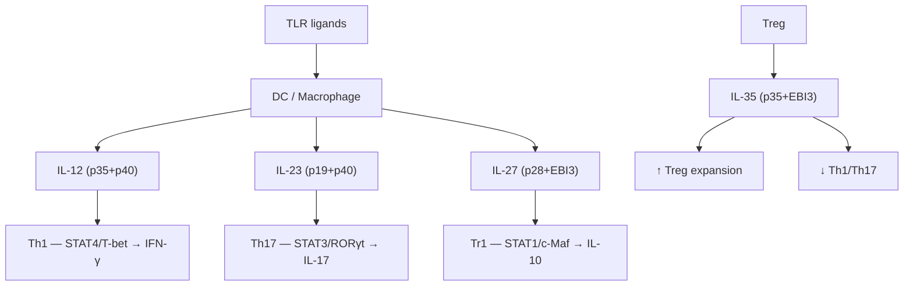

# IL-12 Family Cytokines in Swine — Research Roadmap

**Created:** July 22, 2026 (cron session)
**Card:** KF ID `5c8c4871-13e9-441c-8357-1ddef0200b85` (114 cards total)

## Overview

The IL-12 family is the **only family of heterodimeric cytokines**, with 4 members sharing subunits:

| Cytokine | α subunit | β/γ subunit | Receptor | STAT | Function |
|----------|-----------|-------------|----------|------|----------|
| IL-12 | p35 (IL-12A) | p40 (IL-12B) | IL-12Rβ1+β2 | STAT4 | Th1, IFN-γ, NK, CD8⁺ CTL |
| IL-23 | p19 (IL-23A) | p40 (IL-12B) | IL-12Rβ1+IL-23R | STAT3 | Th17, ILC3, IL-17 |
| IL-27 | p28 (IL-27A) | EBI3 | IL-27Rα+gp130 | STAT1/3 | Dual: Th1↑ + Th17↓, Tr1/IL-10 |
| IL-35 | p35 (IL-12A) | EBI3 | IL-12Rβ2+gp130 | STAT1/4 | Anti-inflammatory (Treg) |

## Key PubMed Queries (tested Jul 2026)

### Round 1 — Broad probes
```
interleukin-12 swine pig Th1                             → 5 PMIDs (40677723, 40293163, ...)
interleukin-23 Th17 pig swine intestinal                 → 1 PMID (22216092)
interleukin-27 pig swine regulatory                      → 1 PMID (29057512)
interleukin-35 pig swine Treg anti-inflammatory          → 1 PMID (28638110)
IL-12 family porcine gut immunity cytokine               → 0 PMIDs
```

### Round 2 — Refined mechanism queries
```
IL-23 pig Th17 intestinal immunity                       → 1 PMID (22216092)
IL-27 pig regulatory T cell                              → 1 PMID (29057512)
IL-35 pig regulatory T cell                              → 4 PMIDs (29057512, 28638110, 24092378, 22867872)
porcine IL-12 cytokine immune response                   → 6 PMIDs (42054951, 41953012, ...)
IL-12 family porcine signaling pathway                   → 3 PMIDs (31379864, 31163250, 10678400)
porcine interleukin-12 p35 p40 gene expression           → 5 PMIDs (22027768, 21087099, 18823664, ...)
```

### Round 3 — General/review + disease context
```
IL-12 family cytokines structure function review         → 5 PMIDs (42231529, 42228582, ...)
porcine IL-12 adjuvant vaccine immune response           → 5 PMIDs (41600939, 41532035, ...)
pig IL-17 Th17 response infection                        → 5 PMIDs (42400750, 41671777, ...)
```

**Total unique PMIDs collected:** 19
**Total rounds:** 3 (broad → refined → review)

## Core Swine-Specific PMIDs

| PMID | Topic | Journal | Year | DOI |
|------|-------|---------|------|-----|
| 40677723 | Age-dependent IL-12/IFN-γ production in porcine PBMC | Front Immunol | 2025 | 10.3389/fimmu.2025.1596490 |
| 40293163 | CD4⁺ T cell subsets during gestation in sows | J Anim Sci | 2025 | 10.1093/jas/skaf142 |
| 27473784 | PRRSV → Th1/Th2 imbalance in DC | Dev Comp Immunol | 2016 | 10.1016/j.dci.2016.07.012 |
| 41115599 | CSFV-2.1 → IL-12 in PAMs | Dev Comp Immunol | 2025 | 10.1016/j.dci.2025.105496 |
| 18823664 | Recombinant porcine IL-12 in E. coli | Vet Immunol Immunopathol | 2008 | 10.1016/j.vetimm.2008.07.015 |
| 21087099 | Anti-p40 porcine IL-12 antibody | Hybridoma | 2010 | 10.1089/hyb.2010.0074 |
| 22027768 | Porcine single-chain IL-12 construction | Nan Fang Yi Ke Da Xue Xue Bao | 2011 | — |
| 15730135 | IL-12p35/p40 mRNA in A. pleuropneumoniae lungs | Vet Res Commun | 2005 | 10.1023/b:verc.0000047488.05304.3e |
| 28638110 | Treg with high IL-35 for xenotransplantation | Sci Rep | 2017 | 10.1038/s41598-017-04322-3 |
| 22867872 | Porcine T cell cytokine mRNA expression | Cytokine | 2012 | 10.1016/j.cyto.2012.07.007 |
| 41600939 | PCV2 VLP → IL-12/Th1 vaccine | Vaccines | 2025 | 10.3390/vaccines14010024 |
| 40441607 | shRNA → IL-12 → FMD vaccine enhancement | Antiviral Res | 2025 | 10.1016/j.antiviral.2025.106202 |
| 36992483 | TLR → IL-12/Th1 from PCV2 antigen | Viruses | 2023 | 10.3390/v15030775 |
| 41671777 | IL-17A review in animal health | Vet Immunol Immunopathol | 2026 | 10.1016/j.vetimm.2026.111078 |
| 41371124 | Multi-epitope G. parasuis → Th1/Th17 | Vaccine | 2026 | 10.1016/j.vaccine.2025.128073 |

## Key Review PMIDs

| PMID | Topic | Journal | Year |
|------|-------|---------|------|
| 42231529 | IL-12 family in autoimmunity — therapeutics | Immunol Invest | 2026 |
| 42228582 | IL-12 family in cardiovascular disease | Immunol Invest | 2026 |
| 41956257 | IL-12β and EBI3 — emerging roles | BBA Mol Cell Res | 2026 |
| 41166989 | IL-27 in gut immunology | Int Immunopharmacol | 2025 |

## Pathway Architecture



## Feed Additive Modulation

| Compound | IL-12 | IL-23 | IL-27 | IL-35 | Mechanism |
|----------|-------|-------|-------|-------|-----------|
| Butyrate | ↓ | ↓ | ? | ? | HDACi → NF-κB |
| Zn (low dose) | ↑ | ↓ | ? | ? | TLR modulation |
| β-glucan | ↑ | ↑ | ? | ? | Dectin-1 → NF-κB |
| Vitamin D₃ | ↓ | ↓ | ? | ↑ | VDR → Treg |
| Arginine | ↑ | ? | ? | ? | mTOR |
| ω-3 PUFA | ↓ | ↓ | ? | ? | PPARγ |
| Saponin | ↑ | ? | ? | ? | TLR4 → NF-κB |
| Retinoic acid | ↓ | ↑ | ? | ? | RAR |

## Virus-Disease Relevance (Swine)

| Virus | IL-12 family involvement | Consequence |
|-------|-------------------------|-------------|
| PRRSV | ↓ IL-12 (DC inhibition) | Impaired Th1, IFN-γ deficit |
| CSFV | ↑ IL-12 (PAM hyperactivation) | Severe inflammation |
| PCV2 | Vaccine → ↑ IL-12/Th1 | Cross-protection |
| PEDV | IL-23/Th17 axis | Mucosal inflammation |
| FMDV | shRNA → ↑ IL-12 | Vaccine enhancement |

## Vietnamese Terminology

| English | Tiếng Việt |
|---------|------------|
| Interleukin-12 family | Họ Interleukin-12 |
| Heterodimeric cytokine | Cytokine dị thể |
| Shared subunit | Tiểu đơn vị dùng chung |
| Th1 differentiation | Biệt hóa Th1 |
| Th17 maintenance | Duy trì Th17 |
| Regulatory T cell (Treg) | Tế bào T điều hòa |
| IFN-γ production | Sản xuất IFN-γ |
| JAK-STAT signaling | Tín hiệu JAK-STAT |

## Tips for Reuse

- **Start with Round 1 broad queries** → if <3 PMIDs per query, go to Round 2 mechanism queries immediately
- **Fetch abstracts only After merging** all PMIDs from ~12-16 queries across 2-3 rounds
- **Dedup check**: search titles for all 4 member names + abbreviations (`IL-12`, `IL12`, `interleukin 12`, `IL-23`, `IL23`, `interleukin 23`, `IL-27`, `IL27`, `IL-35`, `IL35`)
- **Connections to existing KF cards**: JAK-STAT, NF-κB, NLRP3, Th17/Treg balance, IL-6/gp130, TNF/TNFR, IL-10, TGF-β/SMAD, TLR (14 cards total)
